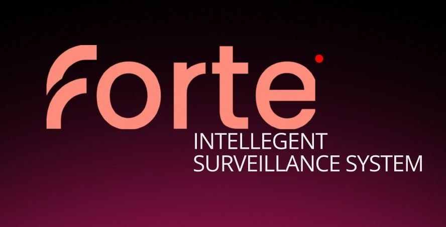

  

<strong>Видеоаналитика для проверки работы кассы</strong>

  <a href="https://belt-fifty-moreover-situation.trycloudflare.com/">Открыть сайт</a> ·
  <a href="README_JURY_RU.txt">Текстовая версия для жюри</a>

## Актуальность

Ручной просмотр кассовых записей занимает время, а короткие нарушения легко пропустить. Forte выделяет эпизоды для проверки и показывает, на каких кадрах основан вывод.

## Что делает

| Возможность | Функции |
| --- | --- |
| **Проверка видео** | Люди, предметы и рабочие зоны; события с наличными, личными вещами, уходом кассира и оставленным включённым экраном. Автоматические и ручные пункты проверки. |
| **Результаты** | Статусы, оценка модели, обоснование и кадры. Повторные наблюдения объединяются в интервалы; спорные случаи выводятся первыми. |
| **Просмотр** | Видео рядом с результатами, шкала событий, переход по времени, фрагмент ±3 секунды, рамки найденных объектов. |
| **Решение проверяющего** | Подтверждение или отклонение, комментарии, уточнение интервалов, добавление пропущенных событий. |
| **История и отчёт** | Сохранённые анализы, поиск и фильтры, показатели качества по проверенной разметке, выгрузка одного HTML-файла с кадрами и решениями. |
| **Доступ** | Загрузка через сайт или API, русский и английский языки, интерфейс для компьютера и телефона. |

> Проценты — некалиброванные оценки модели. «Нет оценки» означает отсутствие числа, а не 0%. Окончательный вывод делает проверяющий.

## Как работает

**Видео → кадры → люди, предметы и зоны → проверка событий → проверка правил → результаты и отчёт.**

| Часть | Стек |
| --- | --- |
| API и задания | Python · FastAPI · SQLite |
| Обработка видео | FFmpeg · OpenCV |
| Люди, позы и предметы | YOLOX-nano · ByteTrack · RTMPose · OWLv2 |
| Проверка событий | Qwen3-VL-4B, 4-битная модель · llama.cpp · GPU |
| Интерфейс | HTML · CSS · JavaScript |

## Как запустить

**Для жюри установка не нужна:** откройте сайт → введите ключ API от команды → выберите `.mov` → нажмите **«Анализировать видео»**.

| Доступ | Адрес |
| --- | --- |
| Сайт | [belt-fifty-moreover-situation.trycloudflare.com](https://belt-fifty-moreover-situation.trycloudflare.com/) |
| API base URL | [https://belt-fifty-moreover-situation.trycloudflare.com/api/v1](https://belt-fifty-moreover-situation.trycloudflare.com/api/v1) |
| Ключ API | Команда передаёт отдельно |

**API:** `POST /api/v1/analyze` — загрузка, multipart-поле `file`; `GET /api/v1/jobs/{job_id}` — статус и результат. Оба запроса требуют заголовок `X-API-Key`.

**Условия демо:** MOV до **95 МБ**, **один анализ за раз**. Ссылка временная и работает, пока сервер команды включён; после перезапуска туннеля адрес меняется.

[Запуск на своём компьютере](docs/local-setup.md) · [Техническая документация и ограничения](README_TECHNICAL.md)
