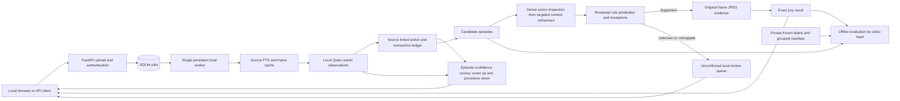

# Historical ForteBank local video review architecture version 2.3

**Superseded for current operation by [hybrid architecture 3.0](hybrid-architecture.md).** This document preserves the earlier design and measurements. Version 3.0 moves boxes to CPU perception, adds transaction state and crop provenance, removes broad catalog prompting, and requires explicit source-linked exception exclusions. Historical results below are not current performance claims.

Revised on 17 October 2026 against the restored original labels, the user's continuous-scoring requirement and diagnostics of the unchanged v2.2 scores. The service identifies visually supported signs of possible cash-discipline violations for human review. Source-linked actions, transaction cues and fractional catalog estimates are extracted before applying legal rules. Event scores start at 0% and rise with occurrence confidence; required-procedure scores start at 100% and fall with confidence in correct completion. Partial evidence can change an estimate without establishing completed protocol or a confirmed violation. The exact jury API and local-only inference remain unchanged.

## 1. Corrected inputs and constraints

The source is `open/open_labels.xlsx`, sheet `labels`, range `A1:C43`. Its SHA-256 is `4faf595a2679c2f8b2b41be041de59bb3c11cd6e77d57226f1cbcc14b2cc3e75`. A byte-identical local snapshot is retained under `data/labels/`; the source workbook is unchanged.

| Input | Verified current content | Design consequence |
| --- | --- | --- |
| Column A | 42 filenames, header `наименование файла` | Preserve exact Unicode names for evaluation joins; never use names for inference. |
| Column B | 22 nonblank weak text annotations and 20 blanks, header `таймстемп` | Extract explicit time-unit anchors locally. These are neither event boundaries nor category labels. |
| Column C | 42 explicit binary verdicts, header `нарушение / без нарушения` | Use this column as the authoritative binary reference. |
| Classes | 22 `нарушение`, 20 `без нарушения` | Evaluate both positive and negative examples; an all-negative reference is obsolete. |
| Unique videos | 40 byte-hash groups: 21 positive, 19 negative | Keep duplicates in the same partition and count each group once. |
| Duplicate annotations | Two duplicate groups; one disagrees on its timestamp, with no binary conflict | Exclude that group from localization until adjudicated, while retaining its unambiguous binary label. |
| Video format | Earlier local media audit: silent H.264 MOV, 464 × 848 portrait; longest 142.533 seconds | Use source presentation timestamps, preserve portrait context, ignore audio. |

All 22 weak timestamp annotations are parsed into point anchors, including a combined minutes-and-seconds expression. The parser does not extract arbitrary numbers from scene text. Explicit contradictory or unrecognized labels are excluded and counted. The previously confirmed blank-means-negative fallback applies only when an explicit verdict is absent; it cannot override column C.

The temporary all-blank workbook had SHA-256 `6a5c0feddc76ed2467dcc6bfc8673402d69e4e1270c1ef1ad6643f6971b99131`. Its report is archived as `docs/evaluation-allblank-superseded.json`; its apparent lack of positives must not be used to assess the detector. Current structural aggregates are in `docs/dataset-audit.json`.

Mandatory constraints remain: all media processing and inference run locally; no videos, frames, or descriptions go to cloud AI; no audio or face recognition; commercially usable model licensing; multiple events and source JPEG evidence; technical failures never become clean results; processing deadline 300 seconds. Public hosting remains deferred by user instruction.

## 2. Why the first architecture is being replaced

The restored reference changes the interpretation of existing completed jobs. The v1 baseline covers four unique groups and has **two true negatives and two false negatives**, with no true positives. This is a small exploratory baseline, not corpus-wide accuracy. See `docs/evaluation-v1-baseline.json`.

V1 did generate candidates: earlier technical smoke runs produced six and nine candidates. It then asked eight sparse context frames to establish transaction boundaries, cash continuity and, in some cases, an omitted procedure. Dense action inspection happened only after that restrictive context gate passed. An uncertainty that denser evidence might resolve therefore prevented that evidence from being inspected.

The corrected labels do not identify the violation categories. They cannot tell us whether a missed positive is a missed supported action, an unsupported category, or a legally unobservable prerequisite. V2 separates proposal coverage, visual verification, legal applicability and manual review so those causes can be measured rather than hidden in one binary outcome.

## 3. Recommended architecture



The labels and reference timestamps have no route into production inference. The local evaluation process matches uploaded bytes to originals by hash after processing. API and UI remain lightweight; the worker owns the model and admits only one active job.

## 4. Stack and hardware

Keep Python 3.12, FastAPI, SQLite, FFmpeg/ffprobe, OpenCV, a separate Python worker, and plain HTML/JavaScript. Keep the pinned **Qwen3-VL-4B-Instruct Q4_K_M** language weights with the F16 vision projector and llama.cpp b11707. Requests use at most eight images at a time, a 6,144-token context, structured JSON, and one GPU request at a time. Screening combines three source-resolution anchors, capped at 960 pixels on the long side, with five height-448 samples. Two v2.3 runtime measurements and a GPU-memory sample are recorded below.

The inspected laptop has an RTX 5070 Laptop GPU with 8 GB VRAM, about 24 GB system RAM, and an Intel i7-13650HX. The existing model already runs on it. Replacing it with an unmeasured larger model would add memory and download risk before fixing the demonstrated evidence-flow problem. CPU operation can be configured but has no five-minute timing claim.

Installed versions are pinned in `requirements.lock.txt`. Model hashes, the pinned model-card Apache-2.0 declaration, llama.cpp MIT notice, actual Python dependency license grants, and native-component conditions are retained in `README.md`, `docs/licenses.md`, `docs/license-audit.json`, and `docs/third-party-licenses/`. Redistribution gaps are documented separately from local-use permission.

The previous optimized v1 longest-clip run took 84.828 seconds from upload to final API response. V2.1 measurements are retained in `docs/local-integration-v2-1.json`; v2.2 smoke timings are recorded below. These are historical; pipeline 2.3 changes prompts, screening resolution and context size and requires new accuracy and latency measurements, even though scoring reuses the existing model calls.

## 5. Taxonomy and legal boundaries

The restored labels are binary. The following is a provisional, regulation-grounded taxonomy, not a claim that every dataset positive belongs to it.

| Category | V2 automation | Required observable context | Public reference and exceptions |
| --- | --- | --- | --- |
| Workstation departure during unfinished cash intake | Eligible after verification | Established intake, active unfinished service, actual departure, referenced pre/action/post context | Resolution 231 §22 in its cash-intake subsection. Standing, reaching or leaving after service does not satisfy this category. |
| Client cash accepted or counted during demonstrable client absence | Eligible after verification | Established client cash intake, identifiable cash lineage, visible client area and concurrent action/absence | Resolution 231 §20. An off-camera or occluded client is unknown; stock preparation and preparatory payout counting are different operations. |
| Earlier client cash exposed during a distinct new transaction | Eligible after verification | Earlier cash identified, prior transaction completed, distinct next transaction active, cash outside designated storage | Resolution 231 §20. An open drawer alone, unidentified stock, or several piles belonging to one client is insufficient. |
| Loose payout cash issued without required counting | **Review-only** | Complete relevant preparation-to-handover opportunity and exclusion of earlier/machine/offscreen counting and packaging exceptions | Resolution 231 §§31(4), 32. Sparse frames cannot establish a missing count. Qualifying intact packs, full straps and packaged coins can be issued by marked amounts. |
| Cup or beverage / presumed personal item | Disabled as an automatic mapping | Contents, ownership, room applicability and exception status are not established by a cup | Resolution 231 §12 has specified exceptions. No coffee inference. |
| Physical identification document not visible | Disabled | A missing paper card does not establish failed identification | Resolution 231 §§19(1), 31(1) permit digital identification. No identity or face analysis. |
| No separate supervisor during an ordinary client transaction | Disabled | Ordinary client intake/payout falls within the relevant exception | Resolution 231 §42. Appearance does not establish roles or authorization. |
| Open door as a universal alarm | Disabled | Room type and applicable arrangement are not established by door state alone | Resolution 14 §§8, 16 concern isolation and closable/lockable capability, not a universal always-closed state. |

Sources: [official Resolution 231](https://adilet.zan.kz/rus/docs/V1900019680), [official Resolution 14](https://adilet.zan.kz/rus/docs/V2000020075). Reviewed operative limits and version provenance remain in `rules/sources/`; no new legal interpretation is inferred from a restored positive label.

V2 can retain an `unmapped_visual_event` for local review. It receives no invented legal citation and never becomes a jury violation merely because it looks unusual. Unseen accounting, authorization, signature validity, receipt delivery, equipment configuration and criminal intent remain outside visual inference.

## 6. Inference pipeline and interfaces

1. **Probe and cache.** Decode video only and index actual presentation timestamps. Initially retain eight samples per 12-second window with an eight-second stride, including the video ending. Screening positions 0, 3 and 7 use original source resolution; the remaining five samples retain height 448. Record the actual maximum sample gap. Cache by source-frame index and size; reuse screen frames for context and decode new frames only when needed. This is a reusable sparse cache, not a claim that every decoded frame was inspected by the model.
2. **Action-first extraction and continuous estimates.** Produce bounded JSON containing visible action facts, observed/uncertain status, supporting input-frame indices, transaction kind/phase cues, visibility, review candidates and estimates for 11 visible catalog checks. The 3 automatic event checks and 8 review-only procedures are assessed in these existing window calls; scoring adds no model calls. Each estimate references supplied source frames. Confidence concerns support for the specified occurrence or correct protocol completion, accounting for required operation, cash, ordering and conditions. Unknown conditions can lower confidence without automatically forcing it to zero. The model can return `partial_support`; an `unresolved` response with nonzero source-linked confidence is normalized to that state while retaining its original model state. Routine facts and partial estimates can be recorded without raising a candidate, marking a procedure completed or confirming a violation. Invalid JSON, schemas or references fail the job.
3. **Grounded ledger and episode scores.** Convert request-local frame indices to original source indices and elapsed timestamps. Preserve every observation privately. Nearby prompts receive a bounded set of source-linked facts. Unknown transaction kind remains unknown and cannot inherit an earlier known kind. Host-ledger observed start cues create fresh transaction assessments; windows with no established episode boundary stay isolated. Each episode starts with event scores at 0 and procedure scores at 100. Source-grounded occurrence confidence raises the event score to `max(previous, 100 × confidence)`; source-grounded confidence in correct completion lowers the procedure score to `min(previous, 100 × (1 − confidence))`. Missing or occluded evidence leaves prior scores unchanged. An unknown-applicability, window-only procedure observation with zero support records incomplete coverage instead of creating a new pending transaction. Unknown legal applicability remains explicit but does not prevent a grounded visual estimate. The ledger establishes neither human identity nor cash ownership. Scoring is separate from the legal gate.
4. **Proposal generation.** Keep eligible mapped candidates, review-only omission candidates and unmapped visible events distinct. Observed departure, handover and access-boundary facts also seed hypotheses deterministically, so a missing model proposal cannot hide those observed actions. Deduplicate nearby overlapping candidates only within the same tentative episode and type. No label, filename, reference timestamp or top-K deadline shortcut controls selection.
5. **Dense action inspection first.** Inspect eight frames around the event anchor over roughly two seconds at height 640. Verify only visible action checks, with a supplied-frame reference for each yes. If the action remains uncertain, inspect its proposed onset-to-ending interval with before/after padding before rejecting it. Anonymous roles and spatial positions are allowed; real-world identity recognition is prohibited. This pass cannot establish unseen legal prerequisites.
6. **Context verification and refinement.** For a supported action, inspect cached pre/action/post context with the reviewed predicates. Include the source images of retained ledger cues; unshown notes cannot establish a predicate. Every yes check must reference provided frames. When a required check is unknown, inspect a targeted view combining denser action frames and nearer before/after frames. Preserve an explicit contradictory `no`; a later pass cannot silently erase it. Refinement is a consistency check using the same model, not an independent expert or calibrated confidence estimate.
7. **Legal gate.** Emit only if every required applicability, context and exception check is positively supported, action verification passes, there is before/after evidence and no material source-timestamp gap. For positive-action categories, `relevant_context_visible` means the relevant context is evidenced; it does not certify continuous absence of some other action. Counting omission is review-only regardless of a model's self-assessment.
8. **Evidence and output.** Re-extract original-size source frames. Select one contextual frame and up to two action frames, deduplicate them, encode JPEG, and attach exact source timestamps. Assemble citations from the registry rather than model-invented law. Sort and deduplicate findings by episode/type/overlap.
9. **Review and audit.** Keep unsupported or uncertain episodes in `details.review_queue`, with reasons and timestamps. Keep catalog estimates and their source references separately from confirmed findings. The summary retains the highest remaining estimate across relevant assessed episodes, including pending procedures; one correctly completed transaction cannot clear another. Repeated overlapping frames never accumulate confidence. Preserve private observations, ledger and verification replies under `data/jobs/`. Technical reports return only counts and timings, not scene descriptions or images.

Core modules are `worker/video.py` (PTS/cache), `worker/ledger.py` (grounded observations), `worker/confidence.py` (window confidence schema, validation and source binding), `worker/scoring.py` (pure continuous confidence updates), `worker/catalog.py` (episode summaries and coverage), `worker/pipeline.py` (episode integration, proposal/refinement/rule gate), `worker/runtime.py` (loopback-only model ownership), and `worker/main.py` (durable jobs, heartbeat and failure recovery).

## 7. API, UI and operation

`POST /api/v1/analyze` authenticates with `X-API-Key`, accepts multipart `file` MOV, and returns HTTP 202 with only `job_id`. `GET /api/v1/jobs/{job_id}` returns only `job_id,status` while processing/failed; a done response additionally returns `verdict` and `violations`. Verdicts remain `violation` or `no_violation`; each violation contains exactly `type,timecode_sec,description,evidence_frames`, and each of its 1–3 JPEG frames contains exactly `timestamp_sec,image_base64`.

The authenticated UI route can include richer coverage, versions, continuous catalog estimates, candidate dispositions and an **unconfirmed** review queue. Fractional estimates may change before the legal gate. Their model self-confidence is uncalibrated and cannot be interpreted as a measured probability of a legal breach. Neither an estimate nor a queue item increments the jury finding count or creates a third API verdict. A completed no-finding result is limited to the supported observable scope and does not certify compliance.

One admitted job protects the 8 GB GPU. Busy admission returns 429 before a job ID; an unready worker returns 503. Accepted jobs have a 300-second deadline. Decode errors, model crashes, malformed output, all-unusable footage and deadline exhaustion return `failed`. Candidates and video endings are not silently dropped to meet time.

The model URL is loopback HTTP only, proxies and redirects are disabled, assets are local, and the UI has no external CDN. Logs do not print API keys or visual descriptions. Public HTTPS routing remains a later task requiring a privacy-compatible route to local inference.

## 8. Corrected evaluation and reproducibility

`python scripts/evaluate_local.py` uses frozen workbook bytes, explicit column C labels, weak point anchors, hash-grouped originals and uploaded-byte hashes. It selects the latest completed result in an exact pipeline version when `--pipeline-version` is specified. Results from v1 and v2 must not be mixed to imply improvement.

The seed-17 private manifest assigns **32 development groups and 8 validation groups**, with validation balanced at four positives/four negatives. The timestamp-disagreement group remains in development. All clips have already had development exposure through earlier local inspection, so this is exploratory grouped validation, not an untouched final test. A new scenario/camera dataset is needed for an external test.

Measure separately:

- Binary confusion counts, precision and recall over completed groups, plus failed and unevaluated groups.
- Proposal timing coverage near reference anchors before legal filtering, versus final event localization at declared tolerances.
- Reasons for review/abstention and the number of refinement passes; an unavailable proposal metric for v1 is not zero proposal recall.
- Human-reviewed event type, evidence relevance, applicability and exceptions. The binary workbook cannot score these automatically.
- Source JPEG validity, frame timestamps, exact API fields, offline behavior, overload, restart, and accepted-job latency.

A local reviewer should assign each positive to supported existing type, missing observable type, unmapped legal interpretation, or unobservable prerequisites. This annotation determines what taxonomy to add. Do not train on private descriptions through a cloud model or weaken legal conditions to match broad binary labels.

Commands:

```powershell
.\.venv\Scripts\python.exe -m pytest -q
.\.venv\Scripts\python.exe scripts/benchmark_local.py --selection data/labels/validation-selection.json --output docs/local-integration-v2-3.json
.\.venv\Scripts\python.exe scripts/evaluate_local.py --pipeline-version 2.3 --output docs/evaluation-v2-3.json
```

The benchmark manifest chooses the longest clip and four balanced validation clips for an initial check. Production inference receives only video bytes under a generic upload name. Broader validation still requires all eight grouped validation clips and eventually all 40 unique groups.

## 9. Implementation priorities and research basis

Implemented: restored-label parsing/provenance, version-filtered evaluation, grouped manifests, action/state ledger, dense-first verification, targeted uncertainty refinement, frame reuse, episode-aware deduplication, review-only omissions, separate UI queue, exact API preservation and continuous episode scoring. The synthetic suite and separate browser checks cover technical behavior. The historical v2.1 run covers five unique clips: TP=0, FP=0, TN=3, FN=2. All jobs completed in 13.204–130.078 seconds, including the longest 142.533-second clip at 130.078 seconds. Eleven proposals covered one of two weak reference anchors within three seconds; no confirmed findings were emitted. These results do not demonstrate improved positive recall, and they do not measure the changed v2.3 pipeline. Technical operation and detection accuracy remain separate questions. Historical reports are `docs/local-integration-v2-1.json` and `docs/evaluation-v2-1.json`; v2.0 is retained separately. No revised accuracy or latency claim is made until v2.3 is evaluated.

Next essential work is local type/interval/exception annotation and error review across positive and negative groups. Then revise candidate mappings only where annotations and a public rule justify them. Estimate 4–8 reviewer hours depending on ambiguity. Complete all eight validation groups and use the resulting error counts to choose whether denser sampling or a specific detector is warranted.

A person/object detector and local tracker are conditional improvements for demonstrated boundary or cash-continuity failures, not substitutes for legal applicability. Any new weights require commercial-license, VRAM and latency checks. Fine-tuning a large VLM on 40 weakly labeled clips is not the first improvement.

The design takes focused visual questions from [VERA](https://arxiv.org/abs/2412.01095), procedural ordering from [Differentiable Task Graph Learning](https://arxiv.org/abs/2406.01486), and pre/action/post effects from [Action Effect Modeling](https://arxiv.org/abs/2512.03474). These motivate the architecture; their published results do not establish performance on bank CCTV. V2 implements a small explicit ledger, not those papers' trained systems.

## 10. Catalog and continuous confidence scoring

The versioned [32-check catalog](violation-catalog.md) extends the review checklist while retaining the three-category automatic finding gate. Six event checks start at 0%; 26 required procedures start at 100%. Initial values are requested baselines, not observations or findings. Event estimates rise continuously with model confidence in occurrence; procedure estimates fall continuously with confidence in correct completion. For example, event confidence 0.42 produces 42%, while completion confidence 0.65 leaves 35%. These fractional values are uncalibrated model self-confidence and have not been validated as empirical probabilities. No additive combination is used for correlated windows, and stronger evidence persists against later unknown observations within one episode.

The 11 visible checks—3 automatic event categories and 8 review-only procedures—receive source-linked window estimates before legal confirmation in the existing model calls. Unknown applicability may coexist with a visual estimate, and an initial/pending procedure score cannot establish an omitted procedure. Correct-completion confidence must concern the required protocol, not a generic action. Partial support changes its estimate without establishing complete performance; unknown conditions stay explicit rather than automatically forcing every estimate to zero. The other 21 checks remain manual and initial unless external evidence is supplied; hidden configuration, authorization and identity checks are not invented from CCTV.

Observed start cues in the host ledger create fresh episode assessments. Windows with unknown boundaries are isolated, preventing an observed completion from clearing unrelated transactions. Unknown, untriggered windows with zero support are coverage gaps and do not fabricate additional pending procedure episodes. The summary retains the highest remaining estimate across relevant assessed episodes, preserving actual pending episodes. Each row separately retains applicability, evidence status, source references, model confidence and `calibrated: false`. Positively evidenced N/A is excluded. Related event/procedure views are linked and never summed; scores across distinct duties are not averaged.

The authenticated UI loads initial values before a job and displays recorded estimates after a new analysis. It explicitly reports known transaction episodes missing this check's assessment, rather than allowing a summary over assessed episodes to imply complete coverage. The exact jury response remains unchanged: only the separate action/context/exception gate produces confirmed findings. A contradictory supported verification with zero confidence is routed to review. Catalog version `2026-10-17-v2`, scoring version `2.1` and inference pipeline `2.3` are recorded separately. All 32 legal catalog items are unchanged. Catalog provenance uses the public clauses already reviewed in this session; a new official-text refresh was unavailable. Operative exceptions and the Resolution 14 transition after 2026 remain explicit.

Revision 2.2 passed 174 Python tests and synthetic continuous-score/browser checks. Real local smoke tests completed an 11.633-second clip in 10.187 seconds and the longest 142.533-second clip in 149.266 seconds. Both returned only unresolved confidence observations, with no score changes or confirmed findings. This establishes operation/timing for those clips, not useful confidence estimates, accuracy or calibration. Reports are `local-confidence-v2-2-smoke.json` and `local-confidence-v2-2-longest.json`.

The v2.3 diagnostics identified a mismatch between continuous scoring and its input contract: the prompt forced uncertain evidence to zero, and the collector rejected uncertain nonzero confidence. A combined screening probe using three source-resolution frames produced three uncertain nonzero estimates that the old collector would reject; focused local question probes still produced zero estimates. The revised collector preserves meaningful uncertain support as `partial_support`, and the prompt no longer makes every unknown condition equivalent to zero. The second fix prevents unknown, untriggered windows from creating fresh 100% procedure episodes that would mask other estimates in the maximum summary. Three higher-detail screening anchors and a 6,144-token context address the low-detail input bottleneck without adding model calls. **195 Python tests and the synthetic browser regression passed** after these fixes.

The real v2.3 short and longest reruns completed in 33.313 and 206.438 seconds respectively (source durations 11.633 and 142.533 seconds). Each produced 4 fractional score changes: 3 event increases and 1 procedure decrease, versus 0 changes in v2.2. Neither emitted confirmed findings. The longest run sampled 18 windows and 106 confidence observations; its phase timings were 12.472 seconds sampling, 160.706 screening and 32.637 verification/evidence. A post-run GPU-memory sample was 6,643 of 8,151 MiB, not a peak profile. Reports are `local-confidence-v2-3-smoke.json` and `local-confidence-v2-3-longest.json`. Confidence updates now operate on these real inputs; detection accuracy, recall and calibration remain unverified.

## 11. Risks and readiness

The main risks remain brief missed actions, uncertain cash lineage, camera-dependent client visibility, incorrect transaction cues, low-resolution packaging, limited taxonomy, and model hallucination. A source reference makes an observation auditable but does not make it true. Same-model repeated agreement is not independent confirmation.

For the demo, show the restored label summary, exact upload/status/result flow, supported evidence, an unconfirmed review item, a negative clip, and an intentional failure. Distinguish the old two-miss baseline from v2 results. Show that labels do not enter inference and that media processing works with off-host networking unavailable.

Do not advertise exhaustive violation coverage, positive recall, unseen-camera generalization or five-minute performance beyond measured workloads. A fast all-negative detector is not a completed accuracy result. Keep the current workbook snapshot, hashes, partition manifest, versioned reports and annotation disagreements together when preparing submission.
