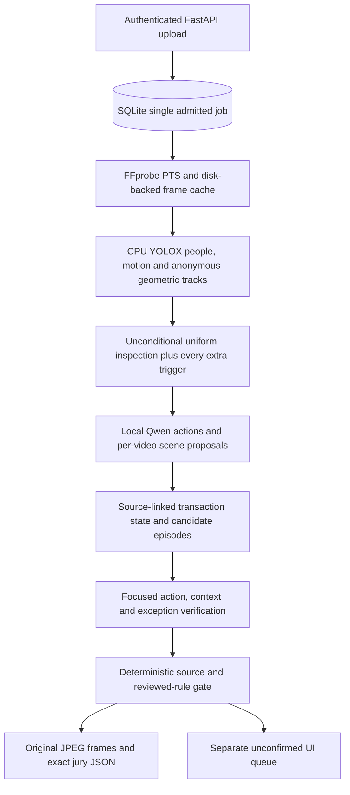

# ForteBank hybrid architecture 3.0

Historical implementation record. The current pipeline is [architecture 4.0](architecture-v4.md); the measurements linked here describe 3.0 only.

Implemented locally on 17 October 2026. This is an evidence-backed review prototype. Its technical tests do not establish banking-event detection accuracy or unseen-camera generalization.

## Data flow



FastAPI, SQLite, admission control, API authentication, persistent worker ownership and the jury schema are preserved. No cloud model, remote recognition, audio processing or face recognition is used. Labels and reference timestamps have no production-inference route. There is no public deployment in this change.

The resident runtime remains local llama.cpp with Qwen3-VL-4B-Instruct Q4_K_M, the F16 vision projector, an 8,192-token context and one GPU request at a time. Source-detail views add image inputs to focused requests; memory and latency are measured rather than inferred from parameter count. [Validation results](hybrid-validation.md) record the final runs and unresolved detection quality.

## Perception and source evidence

`worker/perception.py` performs a complete configurable 5 fps source-PTS pass, including the final source frame. Its CPU YOLOX Nano model exposes COCO person boxes only. Anonymous adjacent-frame IoU tracks are geometric associations; this is not ByteTrack. Missing detections break continuity and record unknown intervals. No role, customer absence, banknote identity, ownership or storage action follows from a track or motion alone.

The installed public weights are pinned and SHA-256 verified. `scripts/setup_perception.py` is a setup-only downloader. Production inference never downloads assets. See [perception provenance, fallback behavior and settings](perception.md). ByteTrack was genuinely compared on cached YOLOX boxes in an isolated CPU environment ([measured diagnostics](tracking-comparison.json)); production retains conservative IoU association because reused IDs across missing detections do not establish continuity and reviewed tracking identities are unavailable.

Uniform 12-second windows with an 8-second stride remain unconditional. Motion/displacement triggers that lack a nearby inspected frame receive additional source-bound windows. A focused local scene call proposes source-linked workstation/customer/counter/storage geometry before perception; older injected test runtimes can provide the same proposal in their first screen response. Newly discovered zone-transition triggers are added to the same inspection plan without a top-K cutoff. If the full workload cannot finish, analysis fails instead of skipping the ending or issuing a clean completed result.

`worker/scene.py` validates normalized scene proposals and supporting supplied-frame references. Missing zones stay unknown. Semantically unusable optional region estimates are discarded to unknown, counted, and exposed as limited coverage; invalid source references and malformed structured responses still fail. The original scene proposal stays in the private job audit. Counter detail crops come from original pixels, preserve source index/PTS, and are supplied alongside full-scene frames. A suspected scene change prevents reuse of geometry across segments and blocks automatic findings whose relevant context crosses that change. Crops add visibility detail; they cannot reconstruct hidden pixels. Runtime requests identify each full/cropped view and explicitly state that outside a crop is unknown.

## Transactions and focused model work

`worker/transactions.py` records observed transitions among unknown, started, active, handover, storage and completed states. Every transition retains source support. Handover or storage does not automatically mean completion. Unknown transaction kinds do not inherit previous intake/payout labels. Explicit conflicting cues and perception gaps remain visible.

The screening request asks for visible actions, transaction cues and candidates. It does not ask the small VLM to simultaneously localize objects, map the room and score eleven procedures. Geometry receives its own narrow call using the same resident model; no separate scene model is loaded.

Candidate verification first checks visible action, then transaction applicability and exceptions. Every positive predicate must reference supplied frames. Uncertainty may receive a targeted refinement. Explicit rejection, contrary predicates or an applicable exception are not overwritten by a later pass. Full/crop provenance is retained in private verification records. Repeated calls to the same model are consistency checks, not independent corroboration.

## Rules, scores and results

The existing reviewed rule registry and enabled scope are unchanged. Three positive-action categories may emit automatically; counting omission remains review-only. `worker/rule_gate.py` adds explicit exception states: excluded, applies or unknown. Every exception must be excluded using affirmative, valid supplied-frame support. Missing, unknown or applicable exceptions block emission.

Public descriptions are templates over the trusted registry label, source event time, document, clause and URL. Free-form model prose cannot add unsupported public allegations. Findings contain 1-3 original-dimension JPEGs with authoritative timestamps. Model boxes and source crops never substitute for original jury evidence.

Catalog rows remain separate from findings. `worker/hybrid_scoring.py` derives event support from focused verification, preserves unknown applicability, and requires the exception gate before marking context applicable. There is no fabricated completion probability from a generic counting gesture. Unsupported procedure and manual checks retain their initial state. All estimates remain uncalibrated.

The UI exposes tentative episodes and perception coverage, preserves the separate review queue, shows exception evidence, and paginates dense detection cards. The jury API remains binary; internally uncertain cases produce a review headline. A completed no-finding result is limited to the supported analyzed scope and does not certify compliance. Technical errors and incomplete deadline processing return failed with no completed verdict.

## Optional temporal model and annotation

The current R3D-18 artifact has a completed exploratory nested evaluation across 40 video-hash groups: balanced accuracy 0.3935, recall 0.5238, specificity 0.2632. It failed the predeclared gate and remains disabled. `worker/temporal.py` does not load Torch by default. Enabling requires a passing artifact and matching evaluation, bound model checksum/configuration/provenance and local encoder assets. Changing only an enable flag or approval boolean does not bypass the gate. Even an approved scorer creates intervals, never legal categories or verdicts.

The source workbook audit remains 42 rows / 40 unique hashes: 21 positive and 19 negative groups. Binary labels and weak point timestamps are not reviewed event categories or boundaries. [The annotation workflow](annotations.md) creates empty drafts and requires explicit human attestation for reviewed imports; it validates video bytes, geometry and exact PTS. It groups duplicates, camera/session and related clips transitively. No real reviewed labels were invented.

## Operation and verification

```powershell
.\.venv\Scripts\python.exe scripts/setup_perception.py
.\.venv\Scripts\python.exe scripts/run_local.py
.\.venv\Scripts\python.exe scripts/check_hybrid_local.py --sample shortest --output docs/hybrid-v3-shortest.json
.\.venv\Scripts\python.exe scripts/check_hybrid_local.py --sample longest --output docs/hybrid-v3-longest.json
.\.venv\Scripts\python.exe scripts/review_annotations.py --help
.\.venv\Scripts\python.exe -m pytest -q --basetemp=tmp/pytest-hybrid-fresh
.\.venv\Scripts\python.exe -m compileall -q app worker scripts
```

The API defaults to localhost:8000; the verification instance may use 8011 with the benchmark's `--url http://127.0.0.1:8011`. Windows sandbox API tests need event-loop socket capability; the default restricted sandbox can stall while creating its loopback socket pair before a test executes.

Engineering budgets are 25 seconds decode/cache, 45 seconds perception/proposals, 150 seconds VLM, 20 seconds evidence/output, and 60 seconds reserve. These are targets, not demonstrated throughput. Perception enforces its stage limit; the accepted-job 300-second deadline is enforced globally. Phase timings, complete sampled coverage and failure states are recorded. GPU maxima sampled by the benchmark are whole-device samples, not a guaranteed instantaneous peak.

Report operation separately from quality: proposal recall, binary precision/recall/specificity, localization, human-reviewed evidence relevance, review/failure rates, processing time and sampled GPU use. Weak-timestamp matching does not establish legal correctness. Existing inspected videos cannot establish independent generalization. Newly reviewed event intervals and a separate camera-angle test are still needed.
